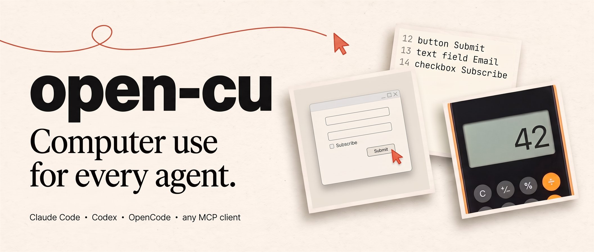
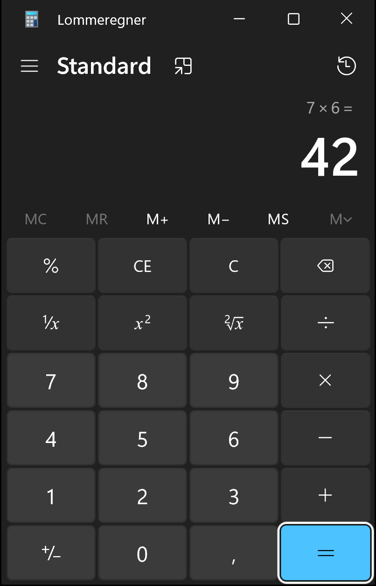

# open-cu



[](#compatibility-and-status) [](#claude-code) [](#codex) [](#opencode-v2) [](#any-other-mcp-client) [](#install) [](#install) [](LICENSE)

**Let your coding agent use the apps on your computer.**

open-cu (Open Computer Use) lets **Claude Code, Codex, OpenCode or any MCP client** read
and operate Windows desktop apps. It can open an app, read its window, click buttons,
fill in forms and type, and it reports back only what changed. It speaks the same tool
language as OpenAI's Codex Computer Use, but it is open source and works with any agent.
With the optional **TypeSafe Jev** model, your agent can simply *describe* what to click.

**12 tools** · **Window reads in ~50 ms** · **Diffs, not dumps** · **Per-app approval** · **Optional Jev targeting**

**Contents** · [See it work](#see-it-work) · [Install](#install) · [First steps](#first-steps) · [Jev targeting](#faster-targeting-with-jev-optional) · [Tools](#what-your-agent-can-do) · [Safety](#safety-and-privacy) · [Troubleshooting](#troubleshooting)

## See it work

A real run on a PC set to Danish (output condensed). The agent names the buttons in
English, and Jev finds the Danish ones: *Syv*, *Multiplicer med*, *Er lig med*. The whole
sequence is one tool call, and the screenshot was captured by open-cu afterwards.

<table>
<tr>
<td>

```text
perform_actions(app: "calculator",
  click: "the 7 key", "multiply",
         "the 6 key", "equals",
  expect: "the display shows 42")

"the 7 key" → 44 button Syv
"multiply"  → 32 button Multiplicer med
"the 6 key" → 43 button Seks
"equals"    → 35 button Er lig med
  Jev confidence 1.00 each, 231–359 ms
  Clicked via UI Automation (invoke)

Changes:
+ 52 text Udtryk er 7 × 6=
~ 12 text Skærm er 42
Expectation: likely met (Jev p=0.96)
```

</td>
<td width="220">

</td>
</tr>
</table>

Without Jev, the agent reads the window and acts by element number:
`click(app: "calculator", element_index: 44)`. Both ways work. Jev saves the agent a read
when it already knows what it wants.

## Install

You need **Windows 10 or 11 (x64)**, [Node.js 22.18+ with npm](https://nodejs.org/en/download),
[Git](https://git-scm.com/downloads), and your agent app. There is nothing to build:
the plugin ships its Windows helper ready to run.

> [!IMPORTANT]
> This repository is currently private. The GitHub account that Git uses on your
> computer must have access to it.

Choose your client:

| Client | Start here |
|---|---|
| **Claude Code** | [Paste two slash commands into your session](#claude-code) |
| **Codex** | [Register the marketplace, then install in Plugins](#codex) |
| **OpenCode v2** | [Run one install command](#opencode-v2) |
| **Anything else that speaks MCP** | [Add one server entry](#any-other-mcp-client) |

### Claude Code

**Inside an interactive Claude Code session**

Paste each command into Claude Code's prompt and press Enter. These are slash commands
for Claude Code, not terminal commands.

1. Add this plugin's GitHub marketplace:

   ```text
   /plugin marketplace add ossianravn/open-computer-use
   ```

2. Open the open-cu install screen:

   ```text
   /plugin install open-cu@open-cu
   ```

3. Select **Install for you (user scope)** to make it available in all your projects,
   and complete the installation.
4. If Claude asks you to reload, enter:

   ```text
   /reload-plugins
   ```

**Ready when** `/plugin` → **Installed** shows **open-cu** enabled, and `/mcp` lists
`open-cu` as connected. Continue with [First steps](#first-steps).

<details>
<summary>Claude Desktop: install through the Code tab's plugin browser</summary>

Use a **local** session in the **Code** tab. Register the private marketplace once, in
your terminal:

```sh
claude plugin marketplace add ossianravn/open-computer-use
```

Then, in Claude Desktop:

1. Click **+** beside the prompt box → **Plugins** → **Add plugin**.
2. Find **open-cu** and open it.
3. Select your **user account** as the install scope and complete the installation.
4. Open **+** → **Plugins** → **Manage plugins** to confirm it is enabled.

A user-scope installation made in a Claude Code session is shared with local Claude
Desktop sessions on the same computer. Cloud sessions cannot operate your desktop.

</details>

<details>
<summary>Prefer terminal commands?</summary>

Run these one at a time in PowerShell or your terminal:

```sh
claude plugin marketplace add ossianravn/open-computer-use
```

```sh
claude plugin install open-cu@open-cu
```

Start a new Claude Code session, or enter `/reload-plugins` in an open one.

</details>

### Codex

**In the desktop app**

1. Open a local Codex chat and paste this request. Codex uses its own command-line tool
   to register the marketplace for your Windows user:

   ```text
   Add the open-cu plugin marketplace for me by running:
   codex plugin marketplace add ossianravn/open-computer-use

   Then run codex plugin marketplace list and confirm that
   open-cu is registered.
   ```

2. Restart the desktop app and open **Plugins**. Select the **Open Computer Use**
   marketplace, open the **open-cu** plugin and click its **+** install button.
3. Start a new chat and paste:

   ```text
   Use open-cu's list_apps tool to show which apps are open.
   ```

**Ready when** Codex lists your open windows. Continue with [First steps](#first-steps).

<details>
<summary>Codex CLI: install from your terminal</summary>

Run these one at a time:

```sh
codex plugin marketplace add ossianravn/open-computer-use
```

```sh
codex plugin add open-cu@open-cu
```

Start a new Codex session and use the `list_apps` request above.

</details>

### OpenCode v2

Run these in your terminal, one at a time:

1. Install the plugin for your user account:

   ```sh
   opencode plugin add github:ossianravn/open-computer-use
   ```

2. Restart OpenCode's background service so it loads the plugin:

   ```sh
   opencode service restart
   ```

3. Check the connection:

   ```sh
   opencode mcp list
   ```

**Ready when** you see `✓ open-cu  connected`. Open OpenCode in your project and
continue with [First steps](#first-steps). The plugin adds both the tools and the
open-cu skill, which teaches the agent the workflow. OpenCode v1 is not supported.

You can also ask OpenCode to run these commands for you.

### Any other MCP client

open-cu is a standard stdio MCP server. Add this entry to your client's MCP
configuration. Most clients use this `mcpServers` shape; some name the key differently.

```json
{
  "mcpServers": {
    "open-cu": {
      "command": "npx",
      "args": ["--yes", "github:ossianravn/open-computer-use", "mcp"]
    }
  }
}
```

The first start downloads open-cu (about 10 seconds); later starts reuse npm's cache.
For agents that also load skills, copy [skills/open-cu/SKILL.md](skills/open-cu/SKILL.md)
into the client's skills folder.

**No MCP at all?** Every tool also runs from the command line, and element numbers carry
over between calls. For example, to read Calculator's window:

```sh
npx --yes github:ossianravn/open-computer-use state calculator
```

`call <tool> -` runs any tool with its JSON arguments read from stdin, which avoids
shell quoting.

## First steps

**1. Ask for something small.** Paste into your agent:

```text
Use open-cu to open Calculator and work out 7 × 6 by clicking its
buttons. Tell me what the display shows.
```

**2. Approve the app.** The first time the agent uses an app, your client asks:
*"Allow open-cu to control CalculatorApp?"* Choose **Allow while this session runs**,
**Always allow CalculatorApp**, **Always allow every app**, or **Deny**.

Some clients can't show this prompt. In that case the agent tells you which app needs
approval, and you approve it from a terminal:

```sh
npx --yes github:ossianravn/open-computer-use approve calculatorapp.exe
```

**3. Watch it work.** While the agent works, a blue glow outlines your screen with a
label at the top, so you always know when an agent is in control:


The agent launches Calculator, presses the buttons through Windows' accessibility
interface (your mouse pointer doesn't move), and reports `42`. Press **Esc** at any
time to stop it.

> [!TIP]
> **The `open-cu` command.** Commands in this README written as `open-cu …` need the
> command installed once:
>
> ```sh
> npm install -g github:ossianravn/open-computer-use
> ```
>
> Or skip the install and start each command with
> `npx --yes github:ossianravn/open-computer-use` instead of `open-cu`.
>
> Useful commands:
>
> - `open-cu doctor` checks everything.
> - `open-cu approval all` approves every app.
> - `open-cu approval prompt` goes back to asking.

## Faster targeting with Jev (optional)

Most of an agent's computer-use time goes into reading. To click "Save", it fetches the
window's whole element tree, finds the right line, then acts. With
[TypeSafe Jev](https://docs.typesafe.ai) turned on, the agent can pass
`target: "the Save button"` and act in one call. Jev is a fast judgment model that
returns a choice with probabilities in about 250–400 ms.

- **It only acts on a clear match.** Jev is asked twice with the options in opposite
  orders, plus whether the element exists at all. Anything uncertain returns a short
  list of candidates and changes nothing.
- **It never guesses destructively.** A pick named *Delete*, *Send*, *Buy* and the like
  is used only when the agent's own words say so.
- **It checks outcomes.** Add `expect: "a Save As dialog opens"` and Jev reports whether
  the observed changes show it.
- **It handles any language.** English descriptions match a Danish Calculator, as shown
  above.

**Set it up:** get a key at [console.typesafe.ai/keys](https://console.typesafe.ai/keys),
then run this in your own terminal and paste the key at the hidden prompt:

```sh
open-cu jev setup
```

It saves the key to `~/.open-cu/jev.env`, turns Jev on and makes a test request.
**Ready when** it prints `Jev targeting: on, model … answered in … ms`. Start a new agent
session to use it.

**Privacy and cost:** element names and roles from the apps you use, plus the agent's
target text, are sent to TypeSafe's API. Screenshots never are. A lookup costs a
fraction of a cent. `open-cu jev off` turns it off; without Jev, targets are matched by
name and nothing leaves your computer. Already using the JEV 9000 plugin? Run
`open-cu jev on --env-file <path to its config.env>` to reuse that key.

More detail in [docs/jev.md](docs/jev.md).

## What your agent can do

| Tool | What it does |
|---|---|
| `list_apps` | Open apps and their windows; `include_installed` adds Start-menu apps |
| `launch_app` | Start an installed app by name (localized names work) |
| `get_app_state` | Read a window as numbered lines, plus a screenshot when needed |
| `find_element` | Rank the elements matching a description, without acting |
| `click` | By element number, by description, or at screenshot coordinates |
| `set_value` | Replace a field, combo box or slider value, and check that it took |
| `type_text` | Type text, with any keyboard layout, accents and emoji |
| `press_key` | Keys and shortcuts such as `ctrl+s`, `Return`, `Page_Down` |
| `scroll` | Scroll a list, document or page |
| `drag` | Drag between two screenshot points |
| `perform_secondary_action` | Expand, Collapse, Show Menu, Toggle, Select, Read Text and more |
| `perform_actions` | Run several steps in one call and report once |

The agent reads a window as compact, numbered lines. The format is the same as Codex
Computer Use, so models already know it:

```text
Window: "Sign up", App: MyApp (pid 20632, window 4851676).
2 text field (focused, settable, string) Full name, ID: fullName
5 checkbox (unchecked) Subscribe to newsletter
7 combo box (collapsed, settable, string) Plan, Value: Free, Secondary Actions: Expand
18 button Submit
```

After each action it gets only the lines that changed:

```text
Clicked 18 Submit via UI Automation (invoke).
~ 16 text Status: submitted
```

Element numbers stay the same for as long as an element exists. Web pages in Chrome and
Edge work too, with links written inline: `see [Personal computer](#87).`

## Safety and privacy

- **You approve each app** on first use, or approve every app with
  `open-cu approval all`. Agents have no tool for approving apps.
- **Always blocked:**
  - terminals;
  - password managers;
  - security and antivirus tools;
  - sign-in and administrator (UAC) prompts;
  - AI agent apps (Claude, ChatGPT, Codex);
  - Windows-key shortcuts.
- **You can see when it's working.** A blue glow around the screen, with the label
  "open-cu is using *App* · Esc to stop", appears while an agent uses an app. It fades
  out after 15 seconds without activity.
  - It never takes focus or blocks a click.
  - It is hidden from screenshots, so the agent never sees it.
  - Turn it off with `"overlay": false` in the config or `OCU_OVERLAY=0`.
- **You stay in charge.** Pressing **Esc** stops every action for 20 seconds and hides
  the overlay at once. The agent also backs off while you are using the keyboard or
  mouse. Only timestamps are kept, never your keystrokes.
- **The agent is told** to ask before sending messages, buying, deleting or changing
  account settings. It never types passwords or payment details, and it treats text on
  screen as data, not instructions.
- **Everything runs locally** except the optional Jev lookups. Settings live in
  `~/.open-cu/config.json`; see [docs/configuration.md](docs/configuration.md).

## How it works

```text
your agent ──MCP──▶ open-cu (Node) ──▶ ocu-win.exe (Rust)
                    tools, safety,       Windows UI Automation,
                    diffs, Jev           input, screenshots
```

A small Rust helper reads windows through Windows UI Automation in a single request per
read. It acts through the controls' own accessibility actions where it can, and falls
back to real mouse and keyboard input when it must. Screenshots stay correct for
covered and DPI-scaled windows. The Node server adds the tool surface, approvals, stable
element numbers, diffs and Jev.

- **Design:** [docs/architecture.md](docs/architecture.md).
- **Codex Computer Use study and related projects:** [docs/research.md](docs/research.md).

## Troubleshooting

| What you see | What to do |
|---|---|
| Repository not found / permission denied | The repository is private: check that your Git credentials have access. |
| `node` or `npm` not found | Install Node.js 22.18+ and reopen your client so it picks up the new PATH. |
| Tools missing after installing | Start a new session. Claude Code: `/plugin` → **Installed**, then `/reload-plugins`. OpenCode: `opencode service restart`, then `opencode mcp list`. |
| `app_not_approved` | Approve the app in the prompt, or run `open-cu approve <app>.exe` (or `open-cu approval all`). |
| `app_blocked` | That app is on the safety block list; do that step yourself. |
| `stopped_by_user` | Someone pressed Esc. Tell the agent when to continue. |
| `user_active` | You were typing or clicking; the agent waits and retries. |
| `target_ambiguous` | Several elements matched. The reply lists them; ask for one by number or describe it more precisely. |
| `Jev targeting unavailable` | Run `open-cu jev status`; `open-cu jev setup` adds or replaces the key. |
| `unsupported_platform` | open-cu runs on Windows only for now. |
| Your antivirus flags `ocu-win.exe` | It is unsigned and watches for your Esc key to stop the agent. Rebuild it from source with `npm run build:native` if you prefer. |

`open-cu doctor` shows the helper, input guard, approvals, Jev and whether your client
can show approval prompts.

## Update or remove

| Client | Update | Remove |
|---|---|---|
| Claude Code | `claude plugin marketplace update open-cu`, then `claude plugin update open-cu@open-cu` | `claude plugin uninstall open-cu@open-cu` |
| Codex | `codex plugin marketplace upgrade`, then reinstall from **Plugins** or `codex plugin add open-cu@open-cu` | `codex plugin remove open-cu@open-cu` |
| OpenCode v2 | `opencode plugin update`, then `opencode service restart` | `opencode plugin remove github:ossianravn/open-computer-use` |
| npx config | Picks up new versions when npm's cache refreshes | Remove the server entry |
| `open-cu` command | `npm install -g github:ossianravn/open-computer-use` | `npm uninstall -g @ossianravn/open-cu` |

Removing the plugin leaves your settings and Jev key in `~/.open-cu`. Delete that
folder to remove them too.

## Compatibility and status

**v0.2.0 is an early release.** On 11 October 2026, these routes were installed from
GitHub on Windows 11, each in an isolated profile. The installed server was then
checked over MCP:

- Claude Code 2.1.288
- Codex CLI 0.160.0
- OpenCode 2.0.18
- npx and global npm (npm 11.17)

Also verified:

- 20 unit tests and 8 end-to-end tests that drive a real app through an MCP client.
- Live runs in Calculator, Windows 11 Notepad and Chrome.

The Codex desktop **Plugins** panel and Claude Desktop's plugin browser have not been
clicked through yet. macOS and Linux have no helper yet: the server starts there but
reports that it only supports Windows. The full evidence and gaps are in
[docs/compatibility.md](docs/compatibility.md).

The package follows [Agent Plugins 1.0](https://agent-plugins.org/specification), with
native manifests for Claude Code and Codex and an adapter for OpenCode v2. It is not
published to npm.

## Development

<details>
<summary>Build, test and contribute from a checkout</summary>

You need Node.js 22.18+ and, for the helper, a Rust toolchain.

```sh
git clone https://github.com/ossianravn/open-computer-use.git
cd open-computer-use
npm install
npm run build:all
npm run check
npm test
npm run test:e2e
npm run validate
```

| Command | Purpose |
|---|---|
| `npm run build:all` | Build the Rust helper and the bundled CLI. Both are committed, so installs need no build. |
| `npm test` | Unit tests; no desktop needed. |
| `npm run test:e2e` | Drives a WinForms test window through a real MCP client. Set `OCU_E2E_JEV=1` to include Jev. |
| `npm run validate` | Manifest, version, skill and artifact consistency. |
| `node scripts/check-installed.mjs <cli.mjs>` | Connect to an installed copy over MCP. |
| `node src/cli.ts <command>` | Run from source without building. |

Contributor notes: [AGENTS.md](AGENTS.md). Design: [docs/architecture.md](docs/architecture.md).

</details>

## License and credits

[MIT](LICENSE). The design draws on public documentation and on studies of
[openai/codex](https://github.com/openai/codex),
[ifuryst/open-codex-computer-use](https://github.com/ifuryst/open-codex-computer-use) and
[amontlabs/lcu](https://github.com/amontlabs/lcu). No OpenAI code is used. See
[docs/research.md](docs/research.md).
